> **Archival notice:** Originally published by Cybereason on May 5, 2024. This copy is maintained for research and portfolio-archival purposes. The [archived original](https://web.archive.org/web/20260226190028/https://www.cybereason.com/blog/behind-closed-doors-the-rise-of-hidden-malicious-remote-access) remains available through the Internet Archive. All rights remain with the original rights holders.

>
> **Original publication date:** May 5, 2024  
> **Original publisher:** Cybereason  
> **Authors:** Mark T. (marktsec)

## Key Observations

- **Stealthy operations:** hVNC and hRDP can provide persistent, concealed access by creating invisible desktop sessions or modifying RDP services.
- **Abuse of legitimate functionality:** These techniques leverage legitimate operating-system capabilities, making benign and malicious activity harder to distinguish.
- **Versatile malicious use:** Beyond persistence, hVNC and hRDP can support data exfiltration, additional malware deployment, and ransomware operations.
- **Detection challenges:** Their covert nature can evade standard security controls. Behavioral analytics and endpoint detection and response (EDR) can help identify anomalous activity associated with hidden sessions.
- **Cybercrime accessibility:** The availability of hVNC and hRDP capabilities in underground marketplaces lowers the technical barrier for attackers who do not develop these techniques themselves.

## What Is hVNC?

### Foundations of Remote Access — VNC

Virtual Network Computing (VNC) is a protocol for remote desktop sharing and control. It allows a user to interact with a remote computer as if they were physically present.

VNC follows a server/client model:

- The VNC server runs on the computer being accessed.
- The VNC client, or viewer, runs on the computer used to control the remote system.
- The Remote FrameBuffer (RFB) protocol transmits keyboard and mouse input from the client to the server, while the server sends graphical screen updates back to the client.

VNC is used for remote administration, technical support, and collaboration.

### The Stealthy World of hVNC

Hidden VNC (hVNC) is a malicious adaptation of VNC. Malware incorporating a VNC server component can provide an attacker with covert access and control over an infected system.

The "hidden" aspect refers to its ability to operate without being visible to the local user. This can enable unauthorized system access and the theft of sensitive information.

### Under the Hood of hVNC

hVNC uses the Microsoft Windows Desktop API to create a hidden desktop through the `CreateDesktop` function.

The concealed desktop is not visible to the user. hVNC can also emulate keyboard and mouse input, allowing an attacker to interact with the compromised system.

Supporting multiple desktops and replicating user input is technically complex because VNC does not inherently support multiple desktop environments. Microsoft Windows provides the `CreateWindowStation` and `CreateDesktop` functions to create additional window stations and desktops, but their use is constrained by desktop heap capacity.

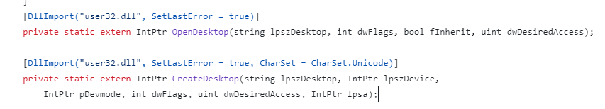
*Figure 1: Example of Win32 API calls included in various RATs.*

## What Is hRDP?

### RDP Overview

Remote Desktop Protocol (RDP), developed by Microsoft, enables remote access to and control of a computer over a network. It provides graphical access to a remote desktop for administration, support, and other tasks.

VNC is platform-independent, while RDP is designed specifically for Windows environments.

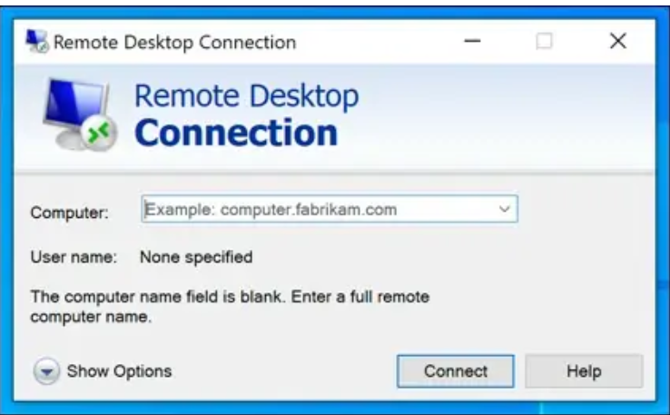
*Figure 2: RDP Connection Prompt.*

### Hidden Remote Desktop Protocol

Hidden RDP (hRDP) is an illicit adaptation of Microsoft's RDP that enables covert remote access to a compromised computer.

The technique typically manipulates Windows session management and desktop display settings so that an RDP session runs without appearing on the victim's monitor.

The technique typically involves manipulating Windows session management and desktop display settings, allowing hRDP sessions to run without displaying any activity on the compromised machine's monitor. Attackers usually accomplish this by reconfiguring the RDP service to listen on a non-standard port and establishing secret user accounts for surreptitious access. Consequently, attackers can perform operations as if they were directly interacting with the system, such as running commands, installing unauthorized software, or extracting data, all without alerting the user or being flagged by security systems.

Malware may install the components required for hRDP, turning an infected machine into a remotely controlled node. This can support stealthy persistence, surveillance, espionage, data exfiltration, and further activity within the victim's environment.

## Analysis

This section reviews remote access tools (RATs) that implement hidden VNC or RDP capabilities and were identified across malware forums.

RATs are malware designed to provide remote control over a victim's computer. They may reach systems through phishing emails, malicious downloads, or software vulnerabilities.

In most contemporary RATs, malware authors are increasingly integrating hVNC and hRDP as optional features. These techniques are, of course, favored by criminal actors for their effectiveness in maintaining persistent, stealth access to compromised systems.

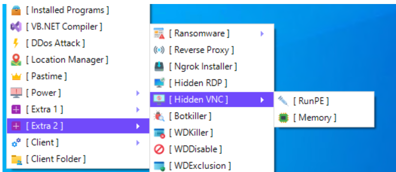
*Figure 3: XWorm user interface showing hVNC and hRDP features.*

### RAT Advertising in Malicious Forums

Malware forums and dedicated Malware-as-a-Service (MaaS) websites represent the evolution of the landscape of cybercrime and the commercialization of malware tools. These platforms not only provide a marketplace but also act as a hub for the exchange of knowledge and tactics among cybercriminals. Among the wares advertised, RATs with hVNC or hRDP are becoming more common.

### Venom RAT

A successor to Quasar RAT known for its wide array of malicious capabilities, Venom RAT is a multi-function malware tool that supports keylogging, surveillance, file management, and remote command execution. Use of hVNC to remain hidden on infected machines is offered as a premium feature for purchase, and includes customer support.

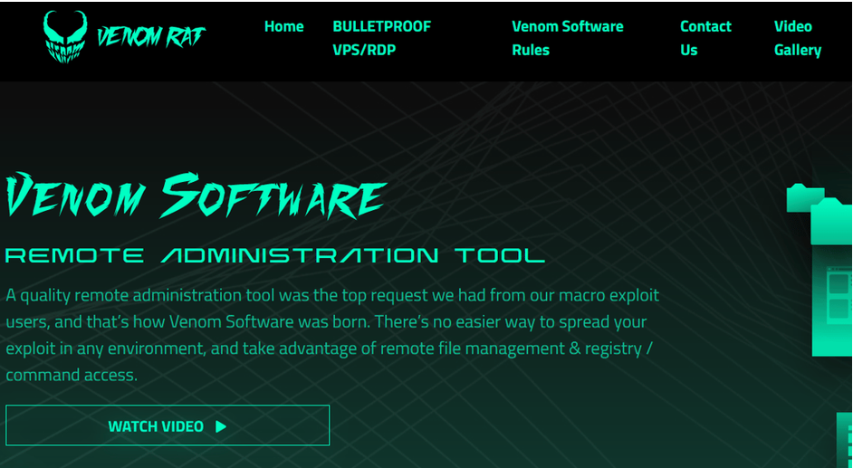
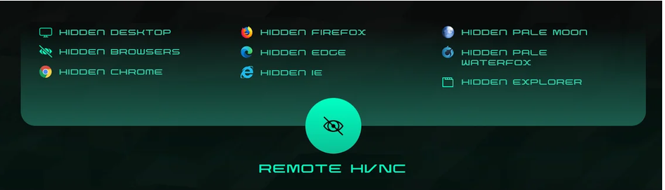
*Figure 4 and 5: Venom RAT hVNC feature advertised on a dedicated website.*

### XWorm RAT

XWorm RAT is a multifunctional tool for Windows, with capabilities associated with espionage, data theft, and system manipulation.

Its encryption of communications between the client and server ensures that transactions remain secure and hidden from network monitoring tools. It now includes advanced hVNC features like copy/paste and file management and monitoring, enhancing the attacker's control over the compromised system. XWorm's capability to run hVNC directly in memory further obscures its presence.

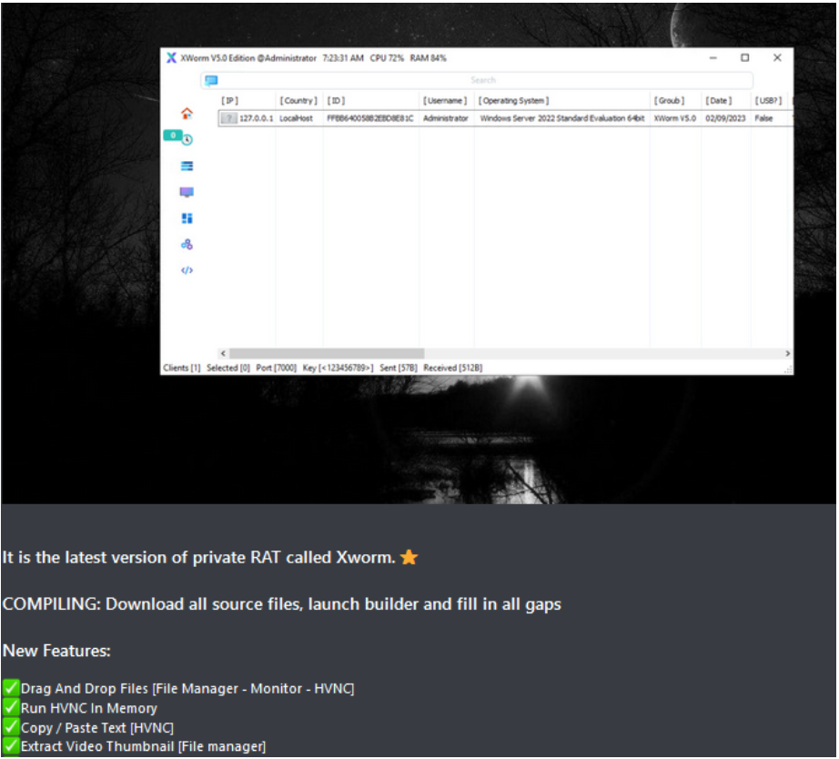
*Figure 6: XWorm RAT hVNC and hRDP features offered on malware forums.*

### Pandora hVNC

Pandora hVNC had been circulating in cybercrime forums since 2021 and was marketed as a tool for covert system control.

It employs reverse connection techniques to circumvent firewall restrictions and includes a lightweight TCP server for efficient and encrypted remote command and control operations. This tool enables complete access and control over infected systems, including mouse and keyboard inputs, and can even navigate two-factor authentication in certain scenarios. Additional features include browser profile cloning for data theft, process suspension, CMD/PowerShell access, crypter compatibility for code obfuscation, and stealth operations through memory-only stub injection, all contributing to its evasion of antivirus detection.

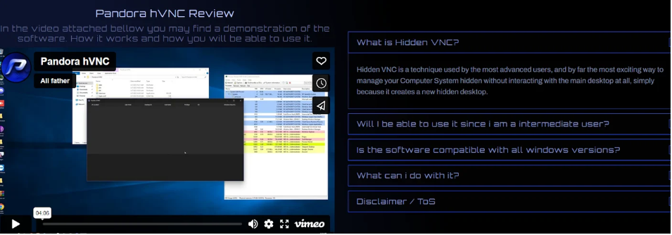
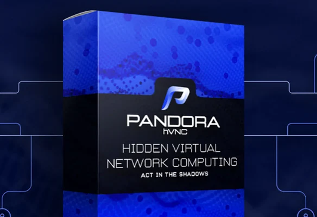
*Figure 7 and 8: Venom RAT hVNC feature advertised on a dedicated website.*

### Xeno RAT

Xeno RAT targets Windows and is written in C#. The report describes it as an advertised open-source RAT with hVNC included as a standard feature rather than a premium add-on.

Alongside hVNC, Xeno RAT boasts a comprehensive feature set aimed at surveillance and system manipulation, including live microphone access, a Socks5 reverse proxy for bypassing network restrictions, and regular updates enhancing its effectiveness and user experience. Its development from scratch signifies a tailored approach to remote access, emphasizing ease of use without compromising on power or versatility

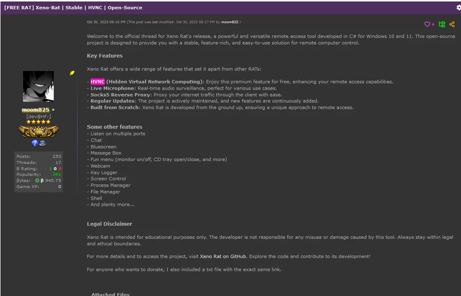
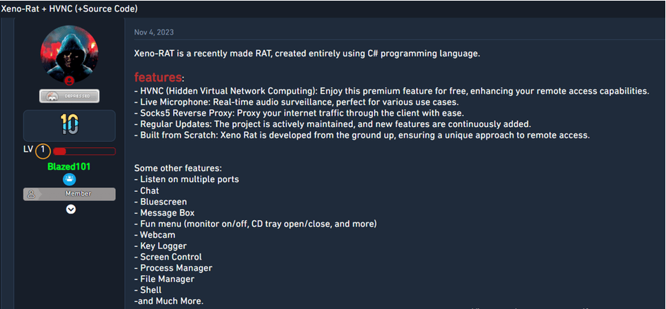
*Figure 9 and 10: Xeno RAT hVNC and hRDP features.*

### Prolific Marketplace

The cybercrime ecosystem thrives via malware forums and dark web marketplaces acting as hubs for the trade of advanced tools and services. Screen captures from these forums reveal listings for malware like hRDP-enhanced tools and Xeno RAT, illustrating the widespread availability and demand for such capabilities.

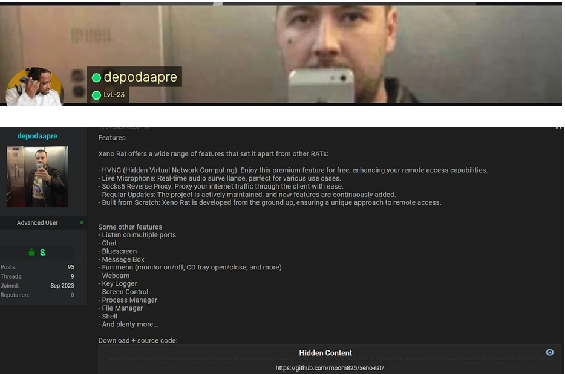
*Figure 11: Malware Seller Account On Malware Forums.*

Cobalt Strike Beacon Object File (BOF) implementation of a hidden desktop, indicating that hidden desktop capabilities were being made available beyond standalone RATs.

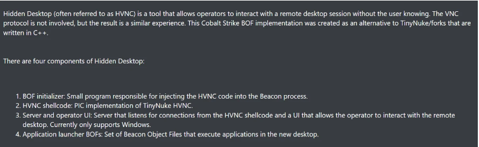
*Figure 12: Cobalt Strike BOF Offering Hidden Desktop Features.*

As these platforms continue to facilitate the proliferation of advanced malware tools, the digital battleground becomes increasingly complex, with hVNC and hRDP serving as critical components in the ever-expanding toolkit of the modern cybercriminal.

## hVNC and hRDP Behavioral Analysis

In this chapter, dynamic analysis included detonation of Xeno RAT and XWorm RAT, observation of the resulting behaviors of using the hVNC and hRDP modules of the malwares. This analysis helps building new detections and understanding how these functionality work at operating-system level.

### Xeno RAT Analysis — hVNC

During testing, Google Chrome opened through hVNC on the attacker's machine but was not visible on the victim's desktop.

PowerShell commands executed through hVNC from the attacker's machine were also invisible to the victim.

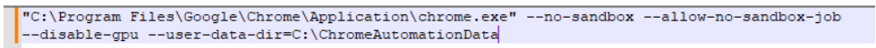
*Figure 13: Command line used by the RAT to open Chrome through hVNC.*

Process Explorer identified two `explorer.exe` processes on the victim's machine. One belonged to the attacker-controlled hidden desktop and was not visible from the victim's desktop, but was visible through the attacker's hVNC session.

Crucially, hVNC is compatible with major browsers, applications, and tools. In this case, Chrome and PowerShell operate as child processes to the attacker-controlled explorer.exe.

### XWorm RAT Analysis — hVNC

Similar to our previous testing but using XWorm RAT, I simulated an attacker opening a browser window covertly on the compromised system.

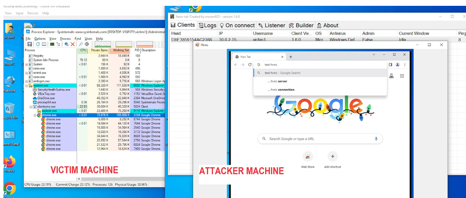
*Figure 14: hVNC Process Tree.*

The XWorm interface offered two deployment options for hVNC:

- **RunPE:** The hVNC process is injected into a legitimate executable already present on disk. This may leave artifacts that security products can detect.
- **In-memory execution:** The hVNC process runs in RAM without writing its components to disk, potentially making it more difficult for antivirus products to detect.

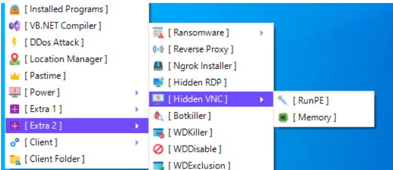
*Figure 15: XWorm hVNC Menu Options.*

In the observed example, the attack used the legitimate process `cvtres.exe` as an injection target.

*Figure 16: injection into the `cvtres.exe` process.*

The injected `cvtres.exe` process established network connections to a remote server.

Attack tree showed the following process chain:

`xclient52.exe` (XWorm) → `cvtres.exe` → `powershell.exe` and `chrome.exe`

The spawned processes were not visible on the victim's desktop.

A further attack-tree example showed `xclient52.exe` spawning `cvtres.exe`, which then spawned `powershell.exe` and `explorer.exe`.

hVNC also observed running in memory without injecting into `cvtres.exe`.

### XWorm RAT Analysis — hRDP

Analysis of XWorm's hRDP feature showed a successful hidden RDP connection.

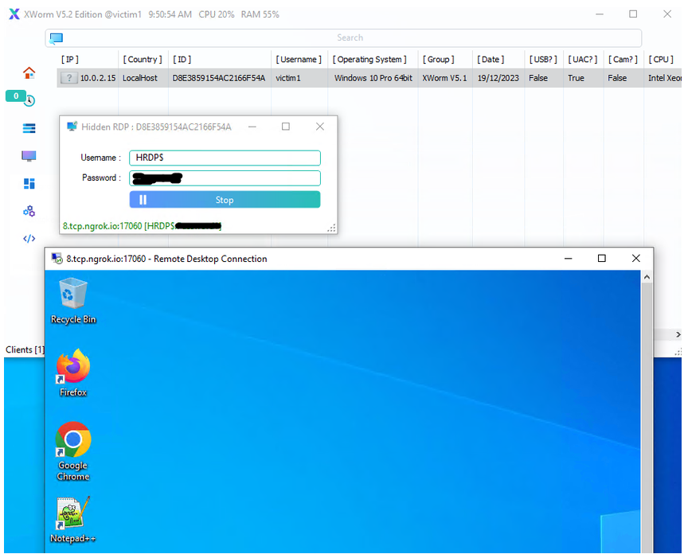
*Figure 17: Successful hRDP connection on the attacker side.*

The resulting process tree showed that a newly created user, `HRDP4$`, owned the Firefox process. Separate user account is created to use a different remote connection session from the victim's, avoiding visible anomalies in the victim's session.

## Detection Opportunities

The original research identifies the following behavioral detection opportunities:

1. **Multiple `explorer.exe` processes:** Look for multiple instances of `explorer.exe`, browser processes, `cmd.exe`, or `powershell.exe` with additional Desktop handles.
2. **Processes invisible to the local user:** Investigate browsers and other processes present in the process tree but not visible on the victim's desktop.
3. **Unexpected or injected parent processes:** Look for unsigned, injected, or unexpected parent processes spawning browsers, command shells, PowerShell, or other sensitive applications that are invisible to the user.
   - Example from the report: the RAT client `XClient52.exe` injects into the Microsoft .NET Framework component `cvtres.exe`, which then spawns Chrome. The browser is invisible on the victim's desktop but visible on the attacker's desktop, with an option to copy the victim's Chrome profile.
4. **Unexpected RDP-enabled users:** Review user accounts and investigate unfamiliar users with RDP access.
5. **Suspicious browser command lines:** Investigate browsers such as Chrome running with unusual command-line parameters.
6. Detection of `rdpwrap.dll`, which can be used to support concurrent remote desktops.

XWorm executes command lines that launch hidden browsers using the unusual Firefox flag `-no-remote-profile` and Chrome flag `--disable-gpu`.

Below is an example of the XenoRATof XenoRAT command line generated by XWorm when launching hidden browsers using the unusual flag -no-remote-profile.
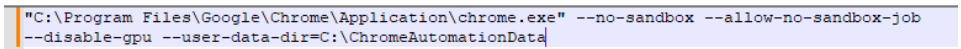

## Conclusion

hVNC and hRDP provide attackers with ways to operate through remote desktop sessions that are hidden from the local user. By abusing legitimate Windows desktop and remote access functionality, these techniques can make malicious activity difficult to distinguish from normal system behavior.

The analysis of Xeno RAT and XWorm RAT demonstrates how hidden sessions can be used to launch browsers and command-line tools, create additional process trees, and maintain remote access without displaying the activity on the victim's desktop.

Detection therefore benefits from correlating process ancestry, desktop/session context, user accounts, injected or unexpected processes, and suspicious browser command lines rather than relying only on whether an application is visibly open.

