> **Archival notice:** Originally published by Cybereason on November 18, 2025. This copy is maintained for research and portfolio-archival purposes. The [archived original](https://web.archive.org/web/20260219162209/https://www.cybereason.com/blog/threat-analysis-beast-ransomware) remains available through the Internet Archive. All rights remain with the original rights holders.

> **Research note:** The analysis and claims below reflect the original publication. Claims made by ransomware operators are presented as claims, not independently verified facts.
>
> **Original publication date:** October 18, 2024  
> **Original publisher:** Cybereason  
> **Authors:** Mark T. (marktsec)

## Key Points

- **Expanding marketplace:** The Beast ransomware group offers a range of tools and regularly updates its versions to appeal to a wider audience in the underground cybercrime ecosystem.
- **Cross-platform targeting:** The Beast RaaS platform provides configurable binaries for Windows, Linux, and VMware ESXi environments.
- **Customizable builds:** Affiliates can configure ransomware binaries to meet different operational requirements.
- **Detection and prevention:** The original report describes Cybereason Defense Platform capabilities intended to detect and block ransomware payloads such as Beast before execution.

## Introduction

The Beast ransomware group has been active since 2022. In June, the group promoted a partnership program and new capabilities on underground forums. The group has developed and updated multiple versions to meet market demand.

Earlier versions of Beast, also known as **Monster**, were developed in Delphi and offered through a Ransomware-as-a-Service (RaaS) model.

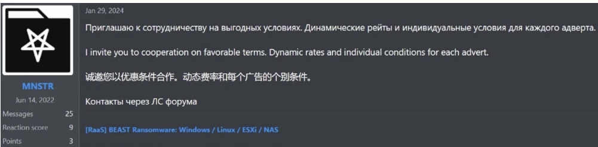
*Figure 1: Invitation to cooperate, advertised in Russian, English, and Chinese.*

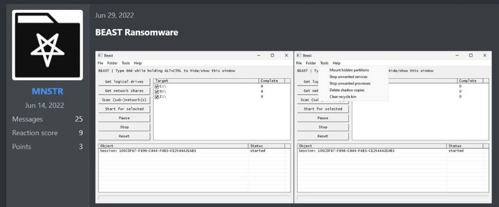
*Figure 2: First appearance of Beast ransomware on the Russian Anonymous Marketplace.*

## Technical Analysis

### Beast Operating System Support — Windows

The Windows versions examined in the original research demonstrated the following capabilities:

- A combination of elliptic-curve cryptography and ChaCha20 encryption.
- Written in the C programming language.
- Segmented file encryption.
- ZIP wrapper mode, in which files are converted on the fly to `.zip` files with the ransom note inside.
- A multithreaded queue for file encryption.
- Termination of processes and services.
- Shadow copy deletion.
- Mounting hidden partitions.
- Subnet scanning.

In August 2024, an offline builder was promoted with options to configure builds for Windows, NAS, and ESXi.

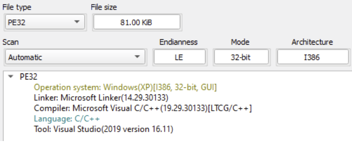
*Figure 3: Beast Windows binary.*

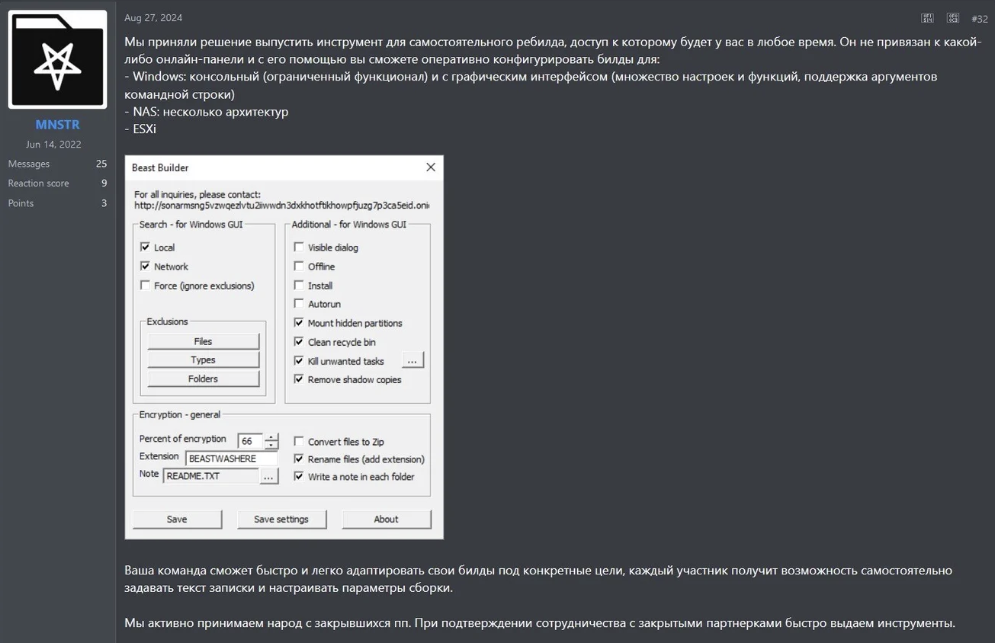
*Figure 4: New Beast offline builder.*

### Beast Operating System Support — Linux and ESXi

The Linux version supports command-line options for:

- Selecting the path to encrypt.
- Enabling or disabling selected functionality.
- Generating a ransom note from an external file.
- Running in daemon mode.

C and Go are programming languages used in the Linux version.

The VMware ESXi version includes additional options:

- Shutting down a virtual machine and encrypting the machine's files.
- Excluding selected VM IDs from processing.

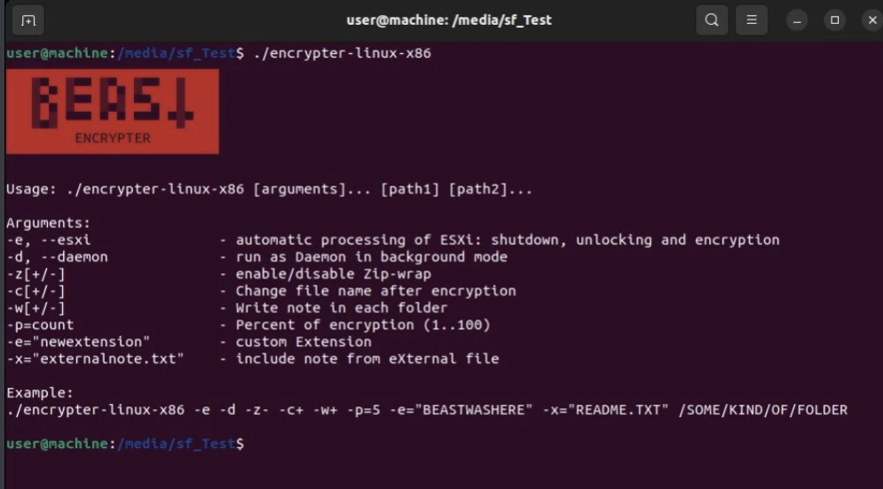
*Figure 5: Linux and ESXi version parameters.*

### Binary Analysis — "BEAST HERE?"

As with many ransomware infections, initial access may occur through different vectors, including phishing emails or compromised Remote Desktop Protocol (RDP) endpoints.

To prevent multiple instances from running simultaneously on the same system, Beast creates a unique mutex containing the string:

`BEAST HERE?`

This mutex helps ensure that only one instance executes at a time.

*Figure 6: Beast creating a mutex object with the `BEAST HERE?` string.*

### Geographical Exclusion

Recent Beast version avoids encrypting devices located in CIS countries, including Russia, Belarus, and Moldova.

The malware checks the system's default language settings and country code, and retrieves the target's IP address. If it identifies the device as being in a CIS country, it stops its encryption activity. The original report assesses this as a possible effort to avoid attracting attention or repercussions from authorities in those regions.

The malware uses `iplogger.co` to query the victim's IP address and location.

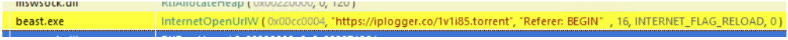

### SMB Scanning

Beast performs SMB scans to search automatically for computers on nearby networks. This is a self-propagation mechanism that can help the payload spread without further user interaction.

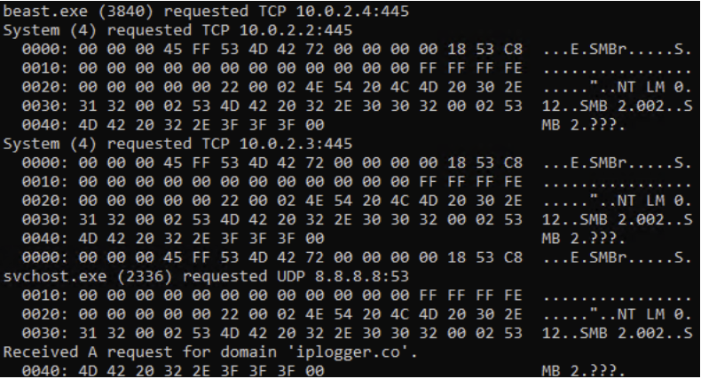

### Restart Manager DLL — `RstrtMgr.dll`

The Windows Restart Manager component helps manage applications and services that have files in use during system updates or restarts. Beast abuses this functionality as part of its file-encryption process.

Before encrypting files, the ransomware stops services and processes to unlock files and close them safely.

A list of services targeted by Beast.

#### Services targeted by Beast ransomware

| # | Service name |
|---:|---|
| 1 | AcronisAgent |
| 2 | BackupExecDiveciMediaService |
| 3 | CAARCUpdateSvc |
| 4 | GxBlr |
| 5 | Intuit.QuickBooks.FCS |
| 6 | AcrSch2Svc |
| 7 | BackupExecJobEngine |
| 8 | CASAD2DWebSvc |
| 9 | GxClMgr |
| 10 | Memtas |
| 11 | Backup |
| 12 | BackupExecManagementService |
| 13 | ccEvtMgr |
| 14 | GxCVD |
| 15 | Mepocs |
| 16 | BackupExecAgentAccelerator |
| 17 | BackupExecRPCService |
| 18 | ccSetMgr |
| 19 | GxFWD |
| 20 | Msexchange |
| 21 | BackupExecAgentBrowser |
| 22 | BackupExecVSSProvider |
| 23 | DefWatch |
| 24 | GxVss |
| 25 | PDVFSService |
| 26 | VeeamDeploymentService |
| 27 | VeeamNFSSvc |
| 28 | VeeamTransportSvc |
| 29 | VSNAPVSS |
| 30 | Vss |
| 31 | YooBackup |
| 32 | YooIT |
| 33 | Zhudongfangyu |
| 34 | MSSQLFDLauncher |
| 35 | MSSQLSERVER |
| 36 | SQLTELEMETRY |
| 37 | MsDtsServer130 |
| 38 | SSISTELEMETRY130 |
| 39 | SQLWriter |
| 40 | MSSQL$VEEAMSQL2012 |
| 41 | SQLAgent |
| 42 | MSSQLSERVERADHelper100 |
| 43 | MSSQLServerOLAPService |
| 44 | MsDtsServer100 |
| 45 | ReportServer |
| 46 | MSSQL$PROGID |
| 47 | MSSQL$WOLTERSKLUWER |
| 48 | SQLAgent$PROGID |
| 49 | SQLAgent$WOLTERSKLUWER |
| 50 | MSSQLFDLauncher$OPTIMA |
| 51 | ReportServer$OPTIMA |
| 52 | msftesql$SQLEXPRESS |
| 53 | PostgreSQL-x64-9.4 |
| 54 | SavRoam |
| 55 | Wscsvc |
| 56 | SQLTELEMETRY$HL |
| 57 | MSSQL$OPTIMA |
| 58 | SQLSERVERAGENT |
| 59 | SQLAgent$VEEAMSQL2012 |
| 60 | SQLAgent$OPTIMA |
| 61 | Veeam |
| 62 | Wuauserv |
| 63 | SQLBrowser |
| 64 | MSSQL |
| 65 | TMBMServer |

### Shadow Copy Deletion

When Beast initiates shadow copy deletion, it uses Windows Management Instrumentation (WMI) through the `IWbemServices` interface.

1. A WQL query using `Select * FROM Win32_ShadowCopy` to obtain shadow-copy objects.
2. `IWbemServices::DeleteInstance` to delete a selected `Win32_ShadowCopy` instance.

This behavior is intended to remove shadow copies that could otherwise help a victim restore files.

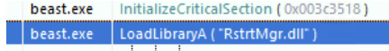

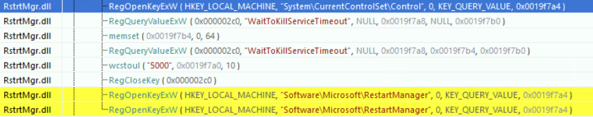

### File Encryption

Beast uses multithreading to accelerate encryption. A parent thread identifies files and distributes them to child threads, which encrypt different files concurrently. This allows the ransomware to use available system resources and process multiple files in parallel.

The ransomware targets multiple file types, including documents, pictures, videos, and databases. Once encrypted, files cannot be accessed without the decryption key controlled by the attackers.

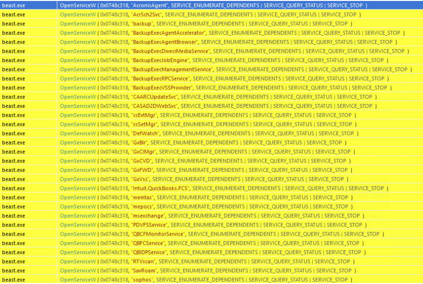

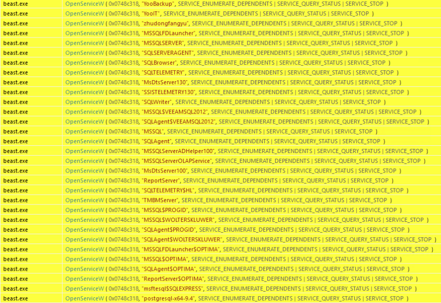

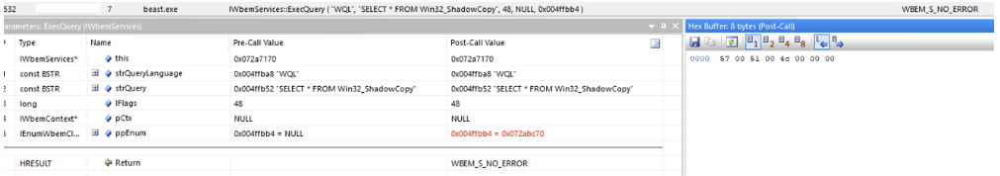

### Ransom Note

A ransom-note thread extracts and decodes the note embedded in the malware's settings. The note is then written as `README.txt` in each directory that is not excluded from encryption.

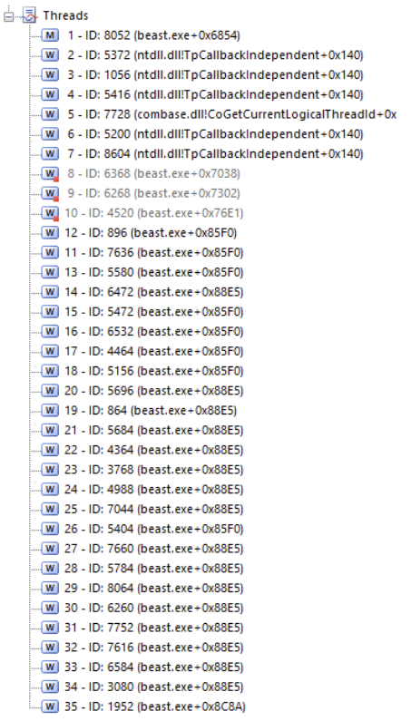

The Beast GUI can be displayed during encryption by holding **ALT+CTRL** and typing **666**.

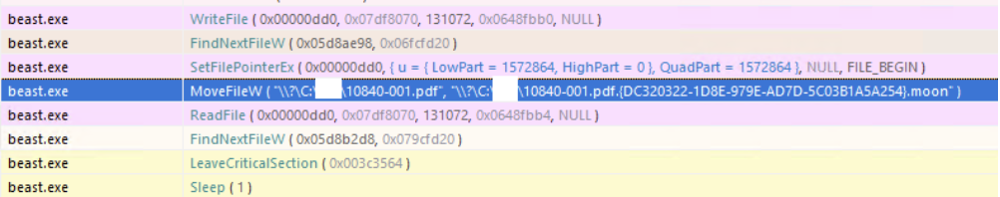

## Indicators of Compromise (IOCs)

| IOC | Type | Description |
|---|---|---|
| `iplogger[.]co/1v1i85[.]torrent` | Domain / URL | Geofencing IP query |
| `4c44ac1eea4bc7f4ea542d611b5658d7ac2729d79abe750da83f1581cd832eaf` | SHA-256 | Beast Windows encryptor |
| `369034bf1d793fe56ea4d683a156722d825ad9829fc128117f82a26bc1d0480b` | SHA-256 | Beast Windows encryptor |
| `e01f5c7067dc984dceb883b10444b1a5b0f22ebd500baf9d9a88207f5033285d` | SHA-256 | Beast Windows encryptor |
| `dd09a2ef31d018fd83f186e3eaaccccdaa8a8c8779ced668abb06dc934d89a2d` | SHA-256 | Beast Windows encryptor |
| `dbbe792e6c804518909f8990a836552573522d126547429d6cd3fcb1f60d542c` | SHA-256 | Beast Windows encryptor |

## Recommendations

- Following and hunting for Beast affiliate activity to identify pre-ransomware behavior.
- Promoting cybersecurity best practices, including multifactor authentication and patch management.
- Keeping systems fully patched to reduce exposure to vulnerabilities.
- Maintaining regular backups and a documented backup policy.

## MITRE ATT&CK Mapping

| Tactic | Technique |
|---|---|
| TA0002 — Execution | [T1047 — Windows Management Instrumentation](https://attack.mitre.org/techniques/T1047/) |
| TA0002 — Execution | [T1106 — Native API](https://attack.mitre.org/techniques/T1106/) |
| TA0003 — Persistence | [T1543.003 — Create or Modify System Process: Windows Service](https://attack.mitre.org/techniques/T1543/003/) |
| TA0007 — Discovery | [T1083 — File and Directory Discovery](https://attack.mitre.org/techniques/T1083/) |
| TA0004 — Privilege Escalation | [T1078.001 — Valid Accounts: Default Accounts](https://attack.mitre.org/techniques/T1078/001/) |
| TA0004 — Privilege Escalation | [T1078.002 — Valid Accounts: Domain Accounts](https://attack.mitre.org/techniques/T1078/002/) |
| TA0007 — Discovery | [T1135 — Network Share Discovery](https://attack.mitre.org/techniques/T1135/) |
| TA0007 — Discovery | [T1016 — System Network Configuration Discovery](https://attack.mitre.org/techniques/T1016/) |
| TA0005 — Defense Evasion | [T1406.002 — Obfuscated Files or Information: Software Packing](https://attack.mitre.org/techniques/T1406/002/) |
| TA0005 — Defense Evasion | [T1620 — Reflective Code Loading](https://attack.mitre.org/techniques/T1620/) |
| TA0008 — Lateral Movement | [T1021.002 — Remote Services: SMB/Windows Admin Shares](https://attack.mitre.org/techniques/T1021/002/) |
| TA0009 — Collection | [T1119 — Automated Collection](https://attack.mitre.org/techniques/T1119/) |
| TA0040 — Impact | [T1486 — Data Encrypted for Impact](https://attack.mitre.org/techniques/T1486/) |
| TA0040 — Impact | [T1489 — Service Stop](https://attack.mitre.org/techniques/T1489/) |
| TA0040 — Impact | [T1490 — Inhibit System Recovery](https://attack.mitre.org/techniques/T1490/) |

## References

- [Some Kind of Monster RaaS Hides Itself Using Traits From Other Malware — BlackBerry](https://blogs.blackberry.com/en/2022/09/some-kind-of-monster-raas-hides-itself-using-traits-from-other-malware)
- [The Nature of the Beast Ransomware — Cyberint](https://cyberint.com/blog/research/the-nature-of-the-beast-ransomware/)
