# The Curious Case of PlayBoy Locker

*An analysis of the PlayBoy Locker ransomware-as-a-service (RaaS) operation.*

> **Archival notice:** Originally published by Cybereason on March 25, 2025. This copy is maintained for research and portfolio-archival purposes. The [archived original](https://web.archive.org/web/20260414182741/https://www.cybereason.com/blog/threat-analysis-playboy-locker) remains available through the Internet Archive. All rights remain with the original rights holders.

> **Research note:** The analysis and claims below reflect the original publication. Claims made by ransomware operators are presented as claims, not independently verified facts.

## Key Points

- **Access to sophisticated attack kits for less-skilled attackers:** The PlayBoy Locker RaaS platform provides a toolkit that enables cybercriminals with limited technical skills to launch ransomware attacks. The offering includes ransomware payloads, management dashboards, and support services. Like many dark-web RaaS providers, the operation uses an affiliate model in which affiliates distribute the malware and share ransom proceeds with the service operator.
- **Binary customization:** The platform offers affiliates multiple options for building ransomware binaries targeting Windows, NAS, and ESXi systems, allowing configurations to be tailored to different operational requirements.
- **Frequent updates and affiliate support:** PlayBoy Locker operators advertise regular updates, anti-detection features, and customer support. RaaS developers may provide troubleshooting, guidance on improving infection rates, and updates intended to evade antivirus and endpoint detection tools. This support infrastructure contributes to a more professionalized ransomware ecosystem.

## Introduction

The PlayBoy Locker group has been active since September 2024. Its initial post on a darknet forum requested beta testers to try the new locker functionality.

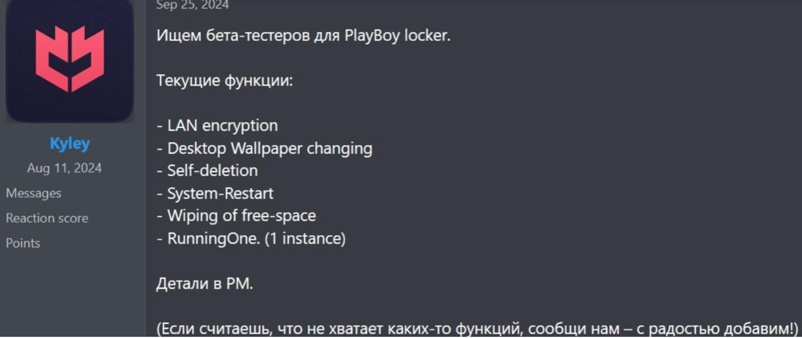

The PlayBoy Locker affiliate program was presented on a dark-web forum. Affiliates were expected to share a percentage of ransom payments with the service operator, with the advertised revenue split set at **85/15%**.

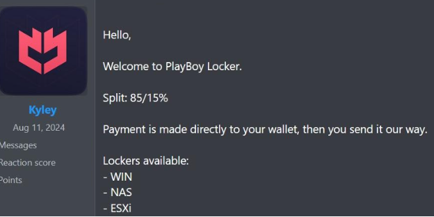

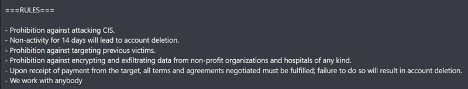

PlayBoy Locker also created an onion site and listed its first victim.


Unexpectedly, the operators later published a sales pitch on the dark web, attempting to sell the project and bring the operation to a close.


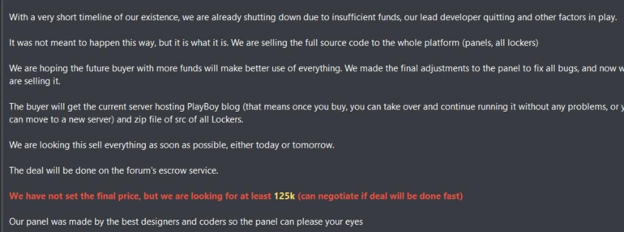

## Technical Analysis

### PlayBoy Locker Operating System Support — Windows

The known Windows versions of PlayBoy Locker demonstrate the following capabilities:

- Uses a combination of **HC-128** and **Curve25519** cryptographic algorithms.
- Written in the **C++** programming language.
- Segmented file encryption.
- Automatic propagation in Active Directory (AD) via LDAP when provided with AD credentials.
- Multithreaded encryption queue.
- Process and service termination.
- Shadow copy deletion.
- System restart.
- Desktop wallpaper modification.
- Restricts execution to one locker process at a time.
- Free-space wiping.
- Customizable ransom note.
- Recycle Bin emptying.

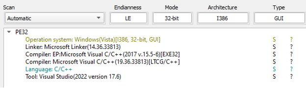

### Additional Support — NAS and ESXi

The PlayBoy Locker offering also includes builds for ESXi and network-attached storage (NAS).

**ESXi version capabilities:**

- Automatically shuts down virtual machines.
- Runs as a daemon.
- Supports file and path exclusions.
- Reported build size of approximately 70 KB.

**NAS version capability:**

- Simple, single-path encryption.

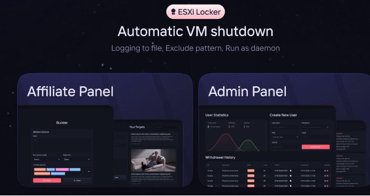

Binary generation can be automated through a web-based builder.

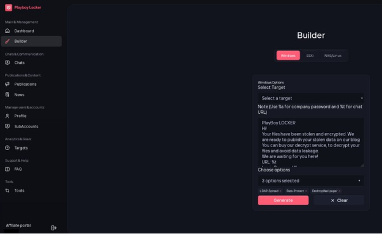

Active chats panel and administration panels.

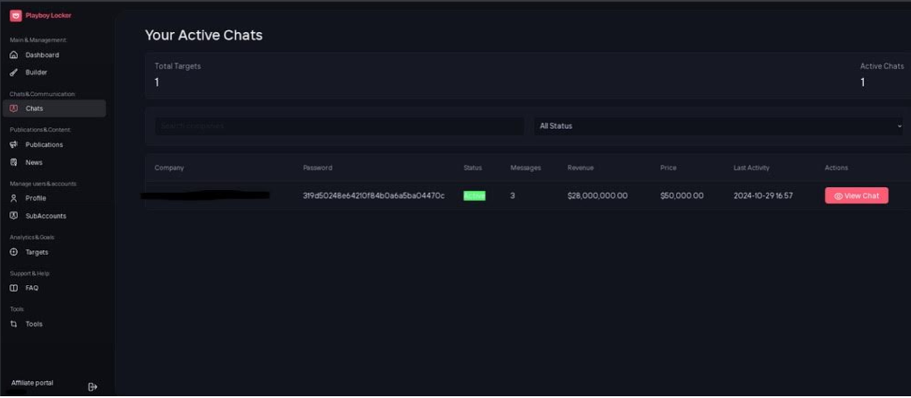

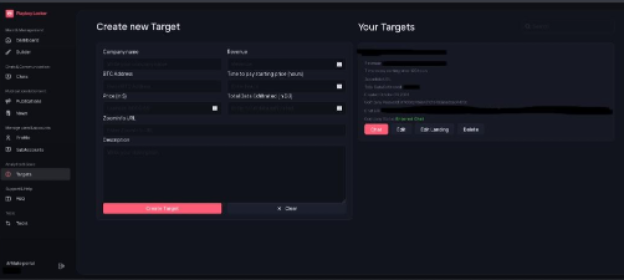

### Binary Analysis

As with many ransomware incidents, initial access may occur through several vectors, including phishing emails and compromised Remote Desktop Protocol (RDP) endpoints.

#### LDAP Scan

The Lightweight Directory Access Protocol (LDAP) is a vendor-neutral application protocol used to access and maintain distributed directory information services over an IP network. It is commonly used to query and manage directory services such as Microsoft Active Directory.

PlayBoy Locker performs LDAP scans to search automatically for machines available on the network. It then attempts to copy the ransomware executable to remote devices and configure a Windows service to execute the payload from the remote location.

The LDAP scan requires the following parameters:

- `-ip` — IP address.
- `-u` — username.
- `-p` — password.

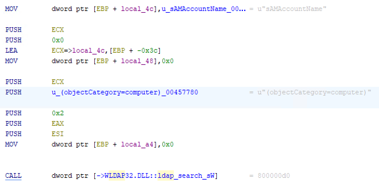

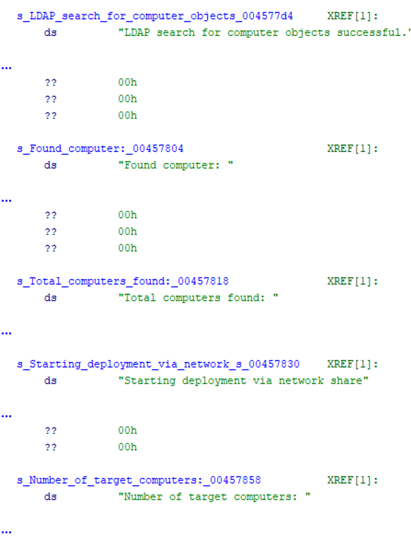

#### Restart Manager DLL Loading

`RstrtMgr.dll` is associated with the Windows Restart Manager, a system component that helps applications and services coordinate restarts when files are in use.

PlayBoy Locker using Restart Manager-related functionality as part of its preparation for encryption. Before encrypting files, the ransomware stops selected processes and services to release files that may otherwise remain locked.

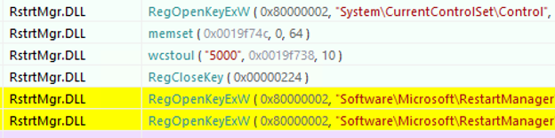

| # | Process / Service |
|---:|---|
| 1 | Telegram |
| 2 | encsvc.exe |
| 3 | powerpnt.exe |
| 4 | msedge.exe |
| 5 | Skype.exe |
| 6 | firefox.exe |
| 7 | steam.exe |
| 8 | sophos |
| 9 | Chrome.exe |
| 10 | tbirdconfig.exe |
| 11 | thebat.exe |
| 12 | veeam |
| 13 | sql.exe |
| 14 | mydesktopqos.exe |
| 15 | thunderbird.exe |
| 16 | backup |
| 17 | Oracle.exe |
| 18 | ocomm.exe |
| 19 | visio.exe |
| 20 | GxVss |
| 21 | ocssd.exe |
| 22 | dbeng50.exe |
| 23 | winword.exe |
| 24 | GxBlr |
| 25 | dbsnmp.exe |
| 26 | sqbcoreservice.exe |
| 27 | wordpad.exe |
| 28 | GxFWD |
| 29 | synctime.exe |
| 30 | excel.exe |
| 31 | notepad.exe |
| 32 | GxCVD |
| 33 | agntsvc.exe |
| 34 | infopath.exe |
| 35 | calc.exe |
| 36 | GxCIMgr |
| 37 | isqlplussvc.exe |
| 38 | msaccess.exe |
| 39 | wuauclt.exe |
| 40 | xfssmsp$ |
| 41 | vccon.exe |
| 42 | ub.exe |
| 43 | mydesktopservice.exe |
| 44 | onenote.exe |
| 45 | memtas |
| 46 | ocautoupds.exe |
| 47 | outlook.exe |
| 48 | mepocs |


#### Shadow Copy Deletion

Deleting shadow copies is a common ransomware behavior intended to prevent victims from restoring files using Windows snapshots.

When PlayBoy Locker initiates shadow-copy deletion, it invokes:

```cmd
vssadmin delete shadows /all /quiet
```


#### File Encryption

Ransomware often uses multithreading to accelerate file encryption. In this approach, a parent thread identifies files and distributes them to child threads, which encrypt files concurrently.

Dynamic-analysis observations show multiple threads operating in parallel. This allows PlayBoy Locker to use available system resources to encrypt files more efficiently.

PlayBoy Locker uses encryption to lock files on connected devices across a network. 

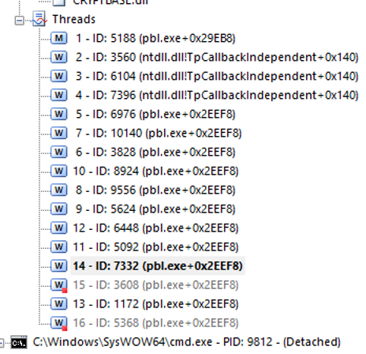

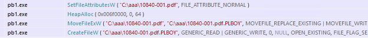

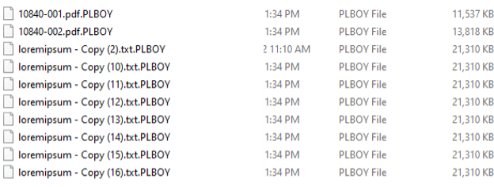

#### Ransom Note

The ransom-note thread extracts and decodes the note embedded in the malware's configuration. It then saves the note as `INSTRUCTIONS.txt` in each directory that is not explicitly excluded from encryption.

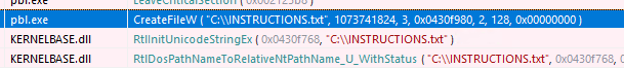

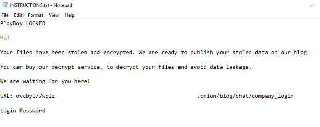

#### Self-Deletion

After completing its operations, the ransomware attempts to remove itself using the following command:

```cmd
C:\Windows\System32\cmd.exe /C ping 127.0.0.1 -n 2 >nul del /F file name
```

## Indicators of Compromise (IOCs)

| SHA-256 | Description |
|---|---|
| `3030a048f05146b85c458bcabe97968e5efdd81b224b96c30c83b74365839e7b` | PlayBoy Locker Windows Encryptor |
| `a9e1bd8f9cbeeec64da558027f380195f7ed572f03830a890dd0494e64d98556` | PlayBoy Locker Windows Encryptor |

## MITRE ATT&CK Mapping

| Tactic | Technique |
|---|---|
| Execution (TA0002) | [T1047 — Windows Management Instrumentation](https://attack.mitre.org/techniques/T1047/) |
| Execution (TA0002) | [T1106 — Native API](https://attack.mitre.org/techniques/T1106/) |
| Persistence (TA0003) | [T1543.003 — Create or Modify System Process: Windows Service](https://attack.mitre.org/techniques/T1543/003/) |
| Discovery (TA0007) | [T1083 — File and Directory Discovery](https://attack.mitre.org/techniques/T1083/) |
| Privilege Escalation (TA0004) | [T1078.001 — Valid Accounts: Default Accounts](https://attack.mitre.org/techniques/T1078/001/) |
| Privilege Escalation (TA0004) | [T1078.002 — Valid Accounts: Domain Accounts](https://attack.mitre.org/techniques/T1078/002/) |
| Discovery (TA0007) | [T1135 — Network Share Discovery](https://attack.mitre.org/techniques/T1135/) |
| Discovery (TA0007) | [T1016 — System Network Configuration Discovery](https://attack.mitre.org/techniques/T1016/) |
| Defense Evasion (TA0005) | [T1406.002 — Obfuscated Files or Information: Software Packing](https://attack.mitre.org/techniques/T1406/002/) |
| Defense Evasion (TA0005) | [T1620 — Reflective Code Loading](https://attack.mitre.org/techniques/T1620/) |
| Collection (TA0009) | [T1119 — Automated Collection](https://attack.mitre.org/techniques/T1119/) |
| Impact (TA0040) | [T1486 — Data Encrypted for Impact](https://attack.mitre.org/techniques/T1486/) |
| Impact (TA0040) | [T1489 — Service Stop](https://attack.mitre.org/techniques/T1489/) |
| Impact (TA0040) | [T1490 — Inhibit System Recovery](https://attack.mitre.org/techniques/T1490/) |
